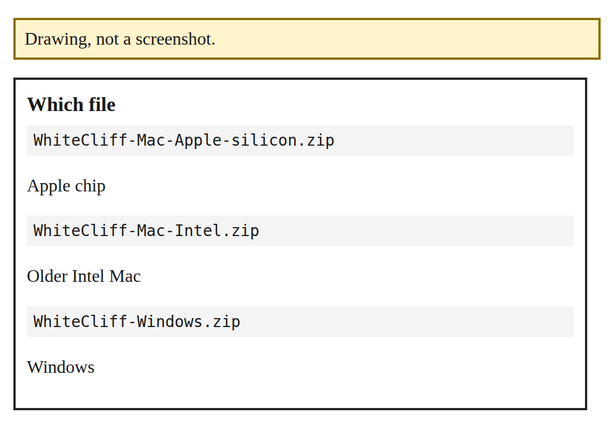
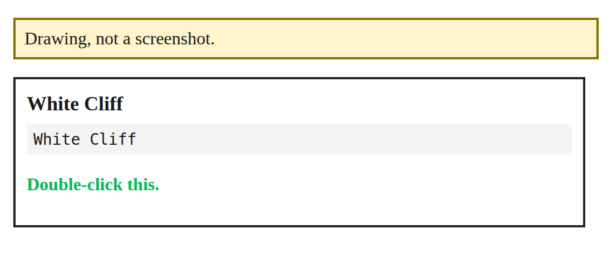
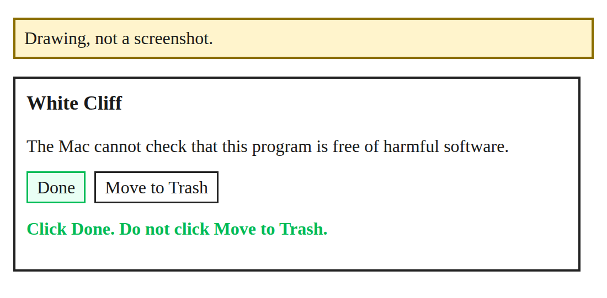
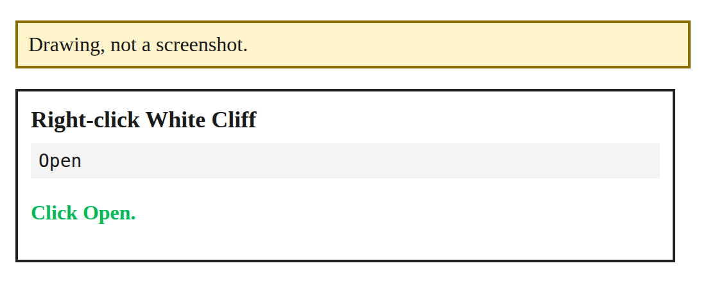
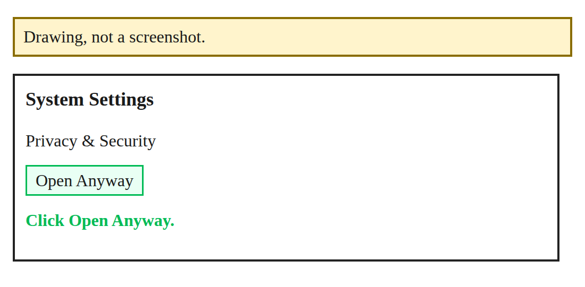
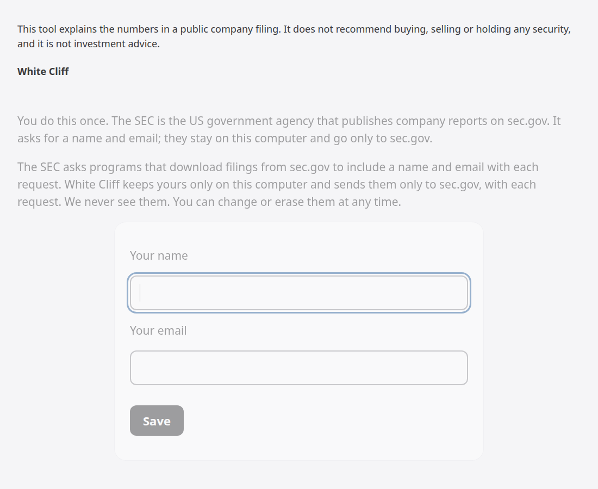
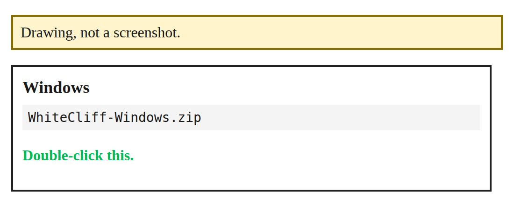
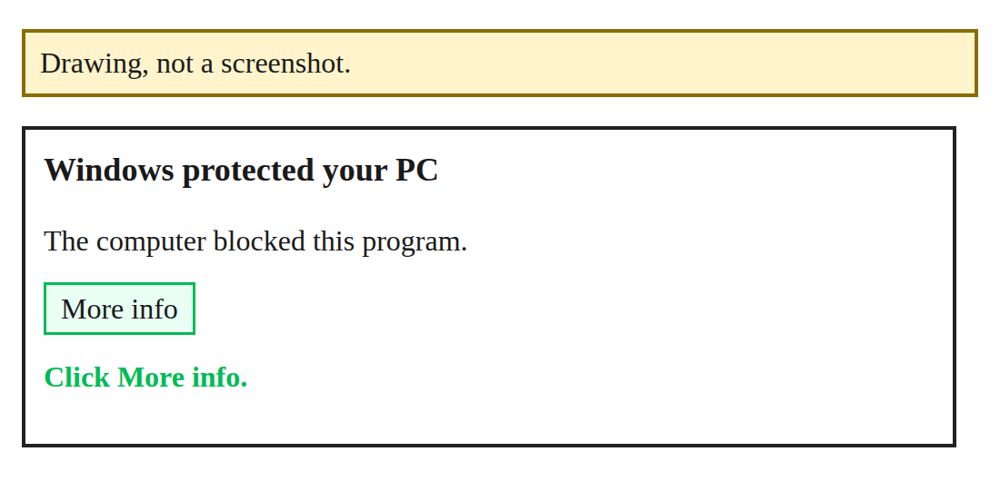
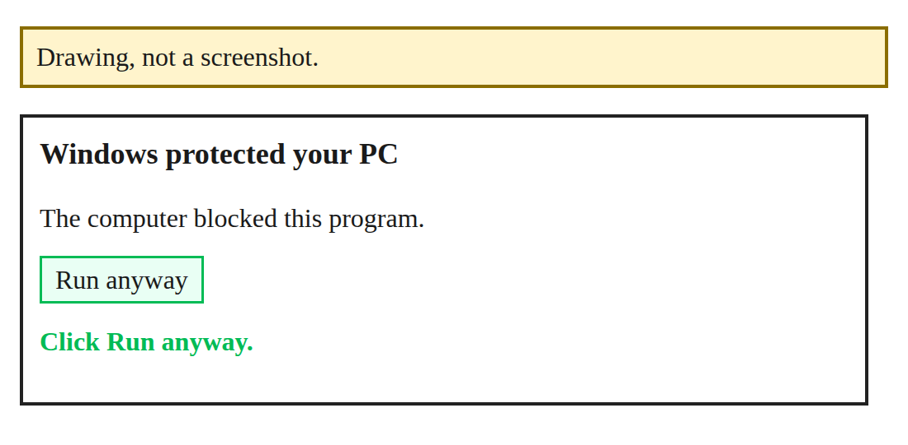

This tool explains the numbers in a public company filing. It does not recommend buying, selling or holding any security, and it is not investment advice.

# white-cliff

## Download

The latest files are on this page:

https://github.com/EE-Holding/white-cliff/releases/latest

Pick the file for the computer. A Mac with an Apple chip uses WhiteCliff-Mac-Apple-silicon.zip. An older Mac with an Intel chip uses WhiteCliff-Mac-Intel.zip. A Windows computer uses WhiteCliff-Windows.zip.

The file is not signed. The computer shows a warning before it opens. Each step has one picture. A yellow box means the picture is a drawing, not a screenshot. The same steps are in [how to open the program](docs/how-to-open.md).

SHA256SUMS.txt lists one long number for each file. Anyone can check that their download matches that number.

### Mac

1. Unzip the Mac file shown in the picture.



2. Double-click White Cliff.



3. Click Done, and do not click Move to Trash.



4. Right-click White Cliff and click Open.



5. Click Privacy & Security, then click Open Anyway.



6. The browser shows a page that runs only on this computer.



### Windows

1. Double-click the Windows file shown in the picture.



2. Click More info.



3. Click Run anyway.



4. The browser shows a page that runs only on this computer.


white-cliff explains a public company filing in plain language. It reads the inline XBRL figures in a US EDGAR annual report or quarterly report and shows revenue, margins, cash flow, debt, and share count. Every figure points back to the filing. The tool does not recommend buying, selling, or holding any security.

Figures come from the inline XBRL tags in that report. A filing of another form, or one with no tagged money figures, is shown without numbers. The tool does not use prices, estimates, news, or any other source. It does not compute price multiples. Explanations use fixed sentences.

## For developers

### Install

```bash
pip install -e ".[dev]"
```

### Commands

Explain a local filing, or write the static pages, with no User-Agent:

```bash
white-cliff explain pinned/filings/0000320193-26-000026
white-cliff explain pinned/filings/0000320193-26-000026 --format html --output explanation.html
white-cliff explain pinned/filings/0000320193-26-000026 --copy
white-cliff site --output docs
white-cliff page --out white-cliff.html
```

`white-cliff page` writes one file from the saved filings. It does not look up new filings.

A User-Agent is needed only for a command that downloads from sec.gov. The package does not include a contact address or a key.

Publish the `docs` directory with GitHub Pages. No separate host is required.

Requests to EDGAR send the User-Agent you configured. The client stays at or under ten requests per second, backs off on HTTP 403 and 429, and refuses any host other than the EDGAR hosts. It fetches only the filing you asked for.

## What every output carries

The disclaimer above is the first paragraph of every explanation, of this file, of `--help`, and of every export. An output that lacks it is refused.

Every shown number comes from the fact store or from a named formula in the formula library. The library records the formula and the input identifiers, and it refuses mismatched units, mismatched periods, and any price input. A section that fails a check is omitted with a reason.

Confidential omissions such as `[***]` are shown as filed. Spans shaped like a social security number, a bank or account number, or a home address are replaced by a source chip.

Quotes, when present, are at most one sentence and 50 words, at most three per section, and each links to the filing on sec.gov.

## Report an error

If a number, source, or omission looks wrong, open a filing error report:

https://github.com/EE-Holding/white-cliff/issues/new?template=filing_error.md

A confirmed misstatement is corrected or the output pulled within 2 business days, with a dated correction note. The log is [CORRECTIONS.md](CORRECTIONS.md).

## Print tests

Print tests that render a PDF need Google Chrome 157. They were checked with Google Chrome 157.0.8103.50. Another major version is a failure, not a skip.

## Pinned filings

The `pinned` directory holds real EDGAR filings, the SHA-256 of each raw file, and hand-checked expected facts. The manifest is a list, so the set can grow to 30 filings. Each filing's sector is the SIC description recorded from its EDGAR submissions file. The set includes an annual report, a quarterly report, and an earnings exhibit.

## License

Copyright 2026 Erik Eicke

Licensed under the Apache License, Version 2.0 (the "License"); you may not use this file except in compliance with the License. You may obtain a copy of the License at

http://www.apache.org/licenses/LICENSE-2.0

Unless required by applicable law or agreed to in writing, software distributed under the License is distributed on an "AS IS" BASIS, WITHOUT WARRANTIES OR CONDITIONS OF ANY KIND, either express or implied. See the License for the specific language governing permissions and limitations under the License.
