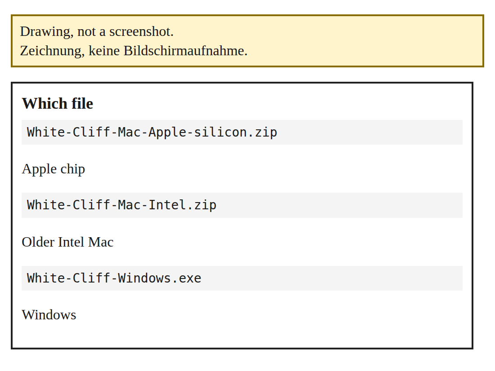
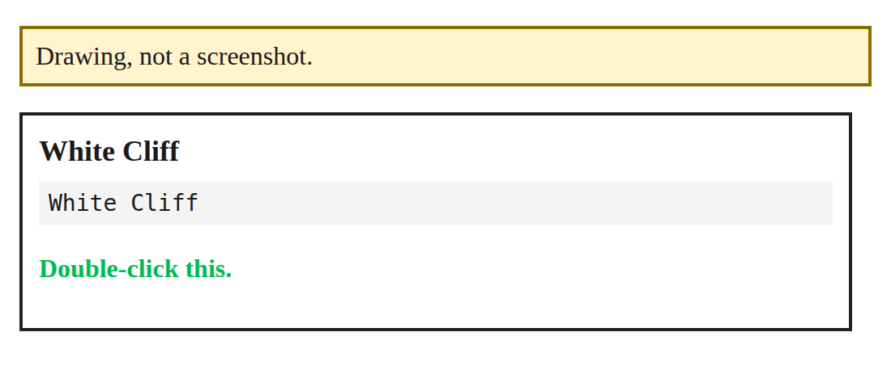
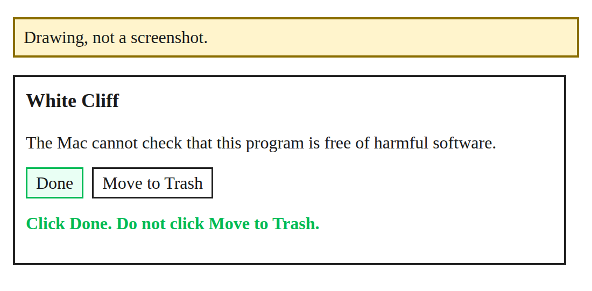
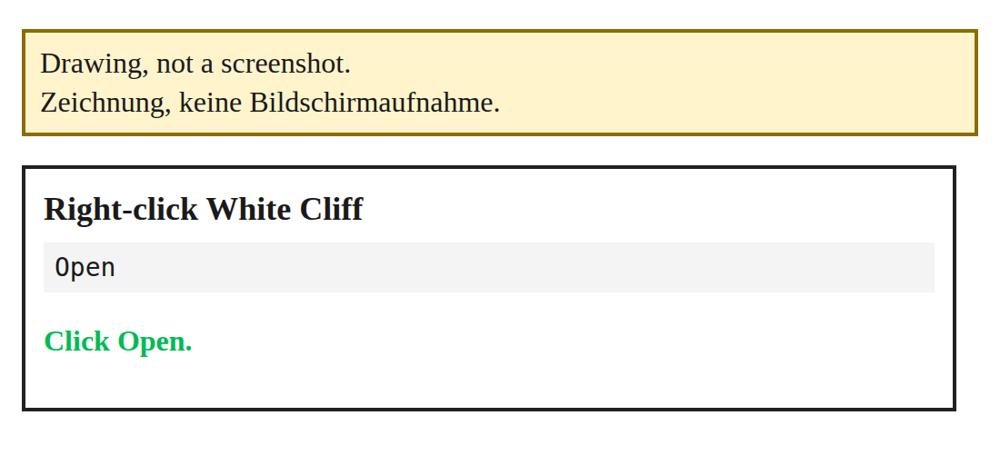
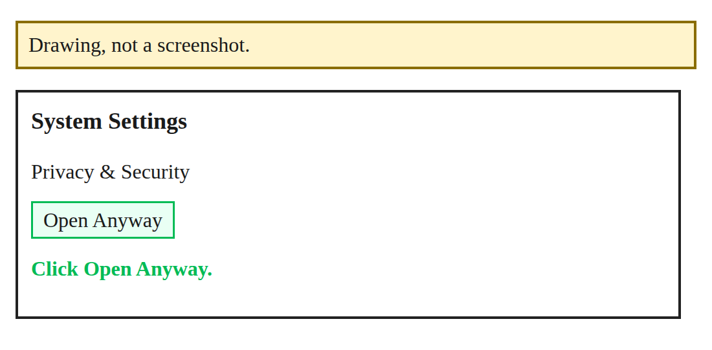
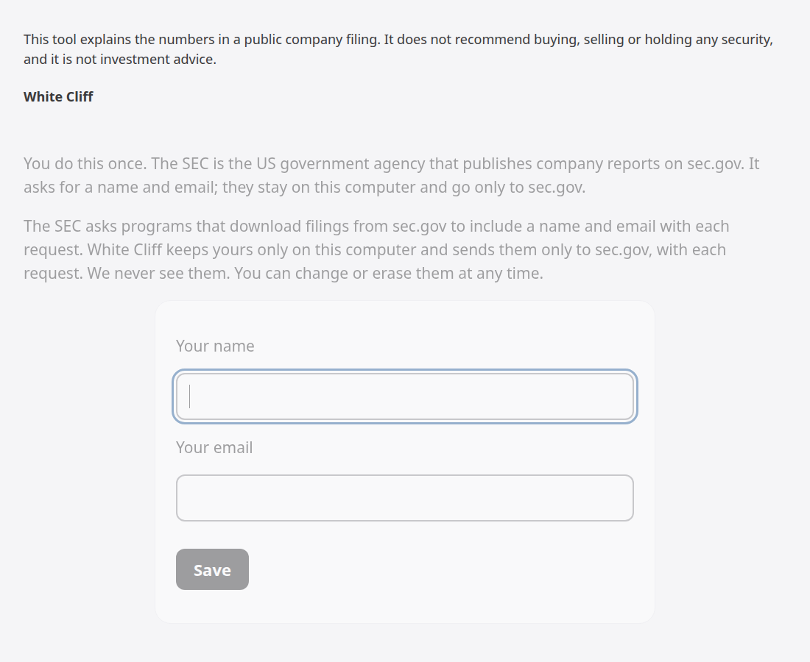
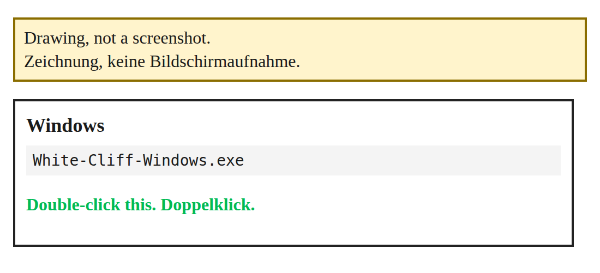
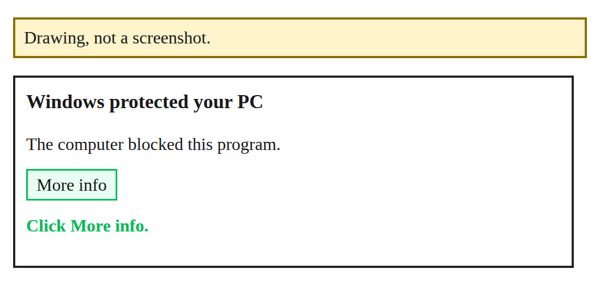
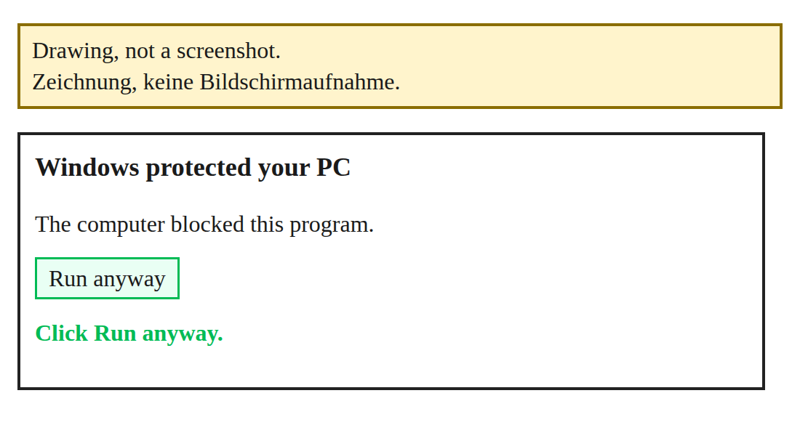

This tool explains the numbers in a public company filing. It does not recommend buying, selling or holding any security, and it is not investment advice.

# How to open White Cliff

White Cliff is open source. Anyone can read the program. The file SHA256SUMS.txt lists one long number for each download. Anyone can check that their file matches that number.

The first lookup is the first live one; the app was tested with saved filings.

The download is not signed. A Mac with an Apple chip uses White-Cliff-Mac-Apple-silicon.zip. An older Mac uses White-Cliff-Mac-Intel.zip. A Windows computer uses White-Cliff-Windows.exe. Each step has one picture. A yellow box means the picture is a drawing, not a screenshot.

## Mac

1. Unzip the Mac file shown in the picture.

2. Double-click White Cliff.

3. Click Done, and do not click Move to Trash.

4. Right-click White Cliff and click Open.

5. Click Privacy & Security, then click Open Anyway.

6. The browser shows a page that runs only on this computer.

## Windows

1. Double-click the Windows file shown in the picture.

2. Click More info.

3. Click Run anyway.

4. The browser shows a page that runs only on this computer.

