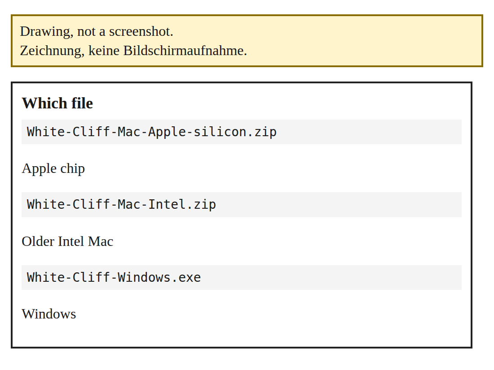
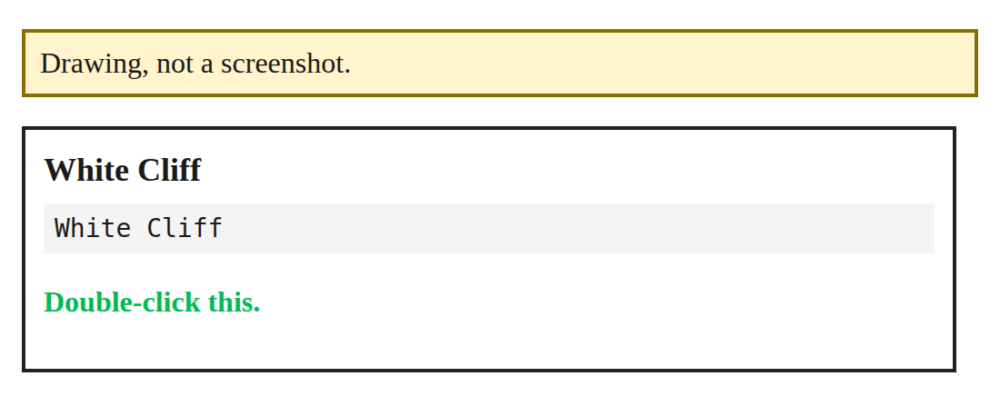
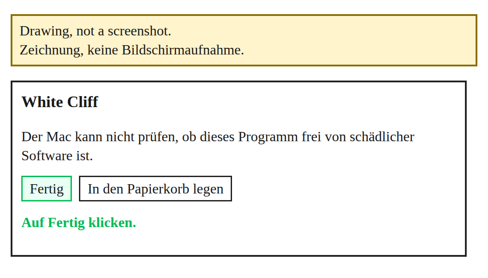
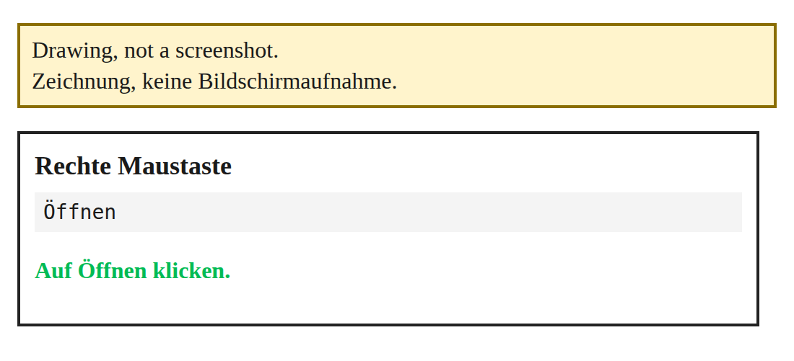
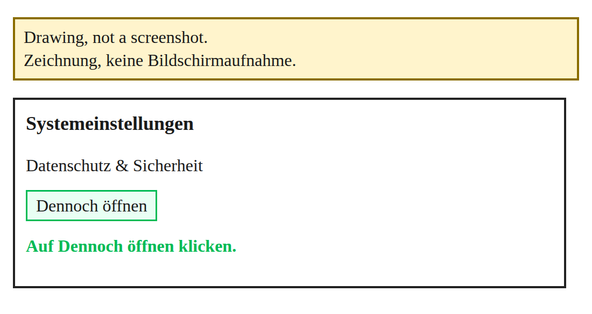
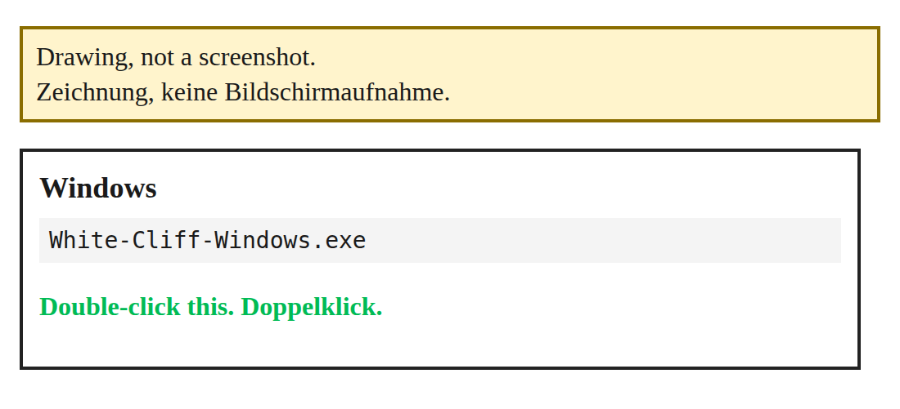
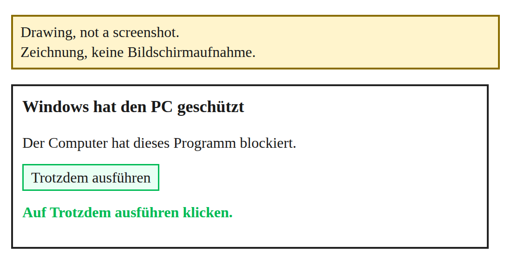

This tool explains the numbers in a public company filing. It does not recommend buying, selling or holding any security, and it is not investment advice.

This German text needs a native review. It is not a certified translation.

Dieses Werkzeug erklärt die Zahlen im Bericht eines börsennotierten Unternehmens. Es empfiehlt weder den Kauf noch den Verkauf noch das Halten eines Wertpapiers und ist keine Anlageberatung.

Dieser deutsche Text braucht noch eine Prüfung durch eine Person mit Deutsch als Muttersprache. Er ist keine geprüfte Übersetzung.

# White Cliff öffnen

White Cliff ist quelloffen. Jede Person kann das Programm lesen. Die Datei SHA256SUMS.txt nennt eine lange Zahl für jede heruntergeladene Datei. Jede Person kann prüfen, ob die Datei zu dieser Zahl passt.

Die Datei ist nicht signiert. Ein Mac mit einem Apple-Chip verwendet White-Cliff-Mac-Apple-silicon.zip. Ein älterer Mac verwendet White-Cliff-Mac-Intel.zip. Ein Windows-Computer verwendet White-Cliff-Windows.exe. Jeder Schritt hat ein Bild. Ein gelbes Feld bedeutet, dass das Bild eine Zeichnung ist und keine Bildschirmaufnahme.

## Mac

1. Die Mac-Datei im Bild entpacken.

2. White Cliff doppelklicken.

3. Auf Fertig klicken, und nicht auf In den Papierkorb legen klicken.

4. White Cliff mit der rechten Maustaste anklicken und auf Öffnen klicken.

5. Auf Systemeinstellungen, Datenschutz & Sicherheit und dann auf Dennoch öffnen klicken.

6. Der Browser zeigt eine Seite, die nur auf diesem Computer läuft.

## Windows

1. Die Windows-Datei im Bild doppelklicken.

2. Auf Weitere Informationen klicken.

3. Auf Trotzdem ausführen klicken.

4. Der Browser zeigt eine Seite, die nur auf diesem Computer läuft.

